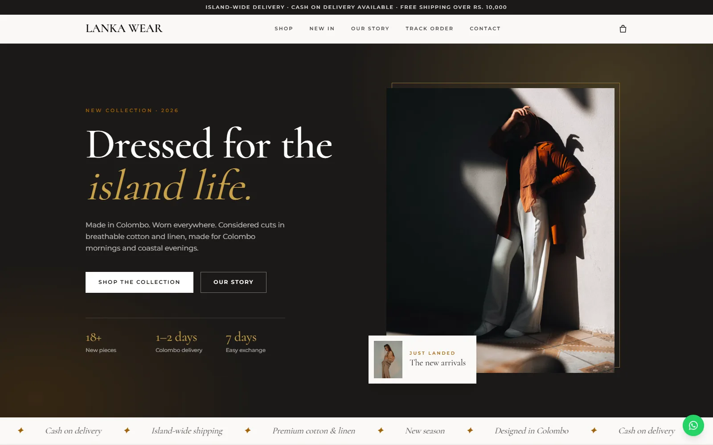
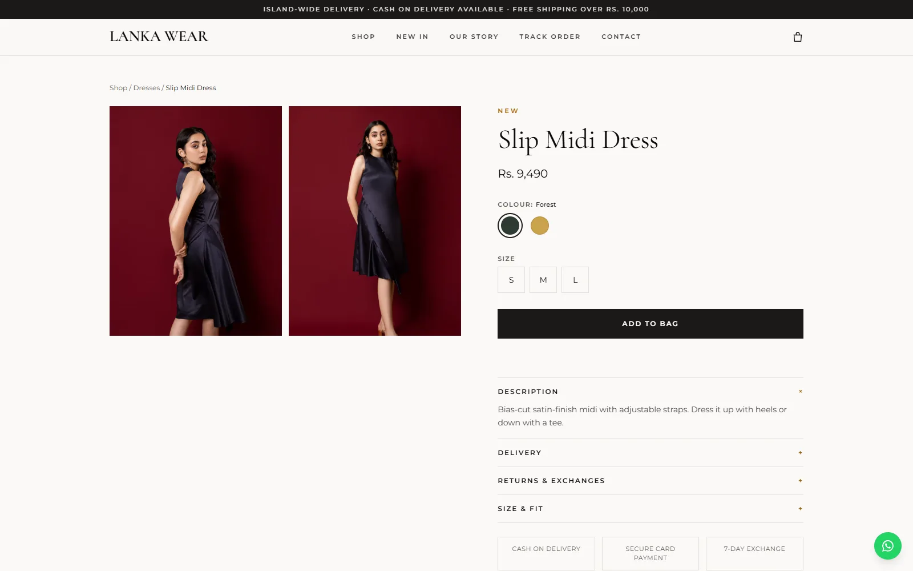
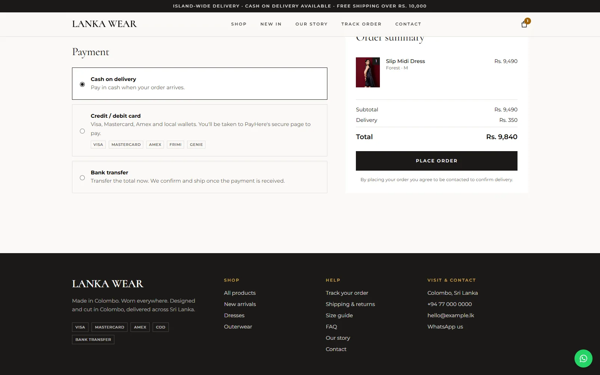
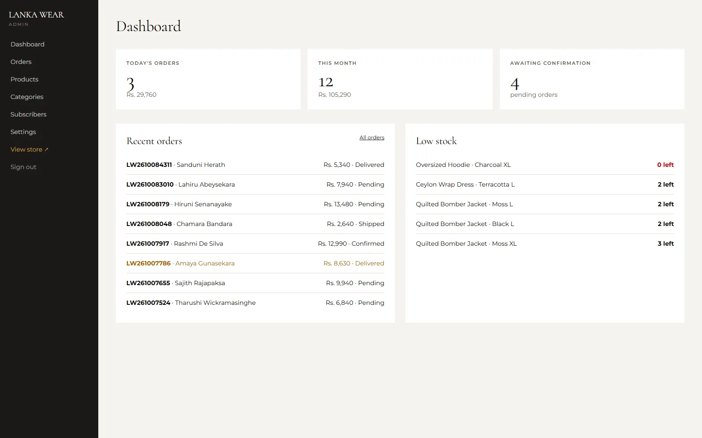
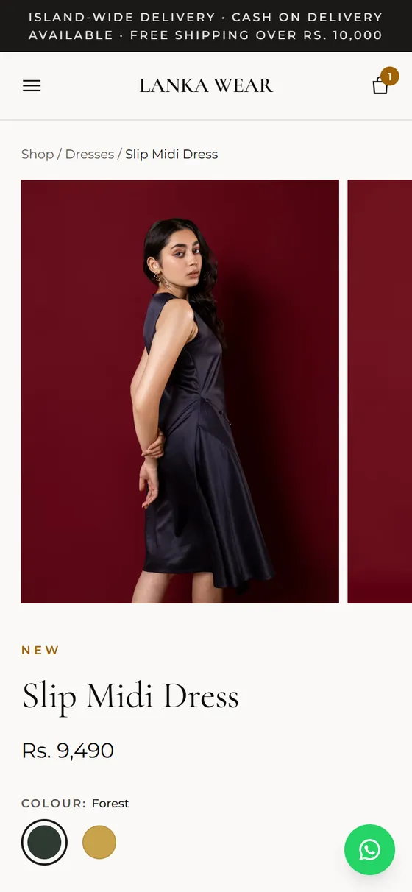

# Lanka Wear

An online clothing store with its own admin panel, built as a prototype for a clothing brand in Colombo, Sri Lanka.

**Live preview:** https://lanka-wear.vercel.app  
**Case study:** https://ashen-portfolio-beta.vercel.app/lanka-wear/



The brand name, contact details and bank details are placeholders, and the product photos are free stock photos from Unsplash. Everything else is working code.

## What it does

**Storefront**
- Products with sizes, colours and stock per combination, photo galleries, sale prices, search and sorting
- Cart that remembers items, with a free-delivery progress bar
- Guest checkout with Sri Lankan mobile number validation and all 25 districts
- Delivery fee by district (Colombo area vs the rest of the island) and a free-delivery threshold
- Pay by cash on delivery, bank transfer (with slip upload) or card through [PayHere](https://www.payhere.lk)
- Order tracking with the order number and mobile number
- Size guide, FAQ, shipping and returns, newsletter signup
- Works down to a 320px screen: swipeable photos, sticky Add to bag bar, slide-in menu

**Admin** (`/admin`)
- Dashboard with today's orders, monthly sales and low-stock items
- Orders: change status, mark as paid, add a tracking note, WhatsApp the customer. Cancelling puts the stock back
- Products: edit variants and stock, upload photos, hide or show
- Categories, newsletter subscribers, and settings for brand details, delivery fees, bank details and PayHere keys

| Product page | Checkout |
|---|---|
|  |  |

| Admin dashboard | On a phone |
|---|---|
|  |  |

## How it's built

Next.js 16 (App Router, server actions), TypeScript, Tailwind CSS 4. No ORM; the app talks to the database through a small layer in `src/lib/db.ts`.

A few choices worth knowing about:

- **Runs on MySQL or Postgres.** The customer will host on a Sri Lankan cPanel server (Node and MySQL), and I also wanted a quick preview on Vercel with Supabase. The data layer reads the connection string and uses the right SQL for each.
- **Orders are checked on the server.** When someone checks out, every line is re-priced from the database and stock is checked inside a transaction, so two customers can't buy the last item together.
- **Card payments go through PayHere's hosted page**, so card numbers never reach this app. Requests are signed on the server, and a payment notification is only trusted after its signature and amount check out.
- **Admin login** is a single account set with environment variables and a signed, expiring cookie. Payment slips are only served to a logged-in admin.

## Running it locally

You need Node 20+ and a MySQL or Postgres database.

```bash
npm install
cp .env.example .env.local     # fill in DATABASE_URL, AUTH_SECRET, ADMIN_EMAIL, ADMIN_PASSWORD
```

Create the tables and load the demo catalogue:

- MySQL: run `mysql/schema.sql`, then `mysql/seed.sql`
- Postgres: run `supabase/schema.sql`, then `supabase/seed.sql`

```bash
npm run dev
```

Open http://localhost:3000, and http://localhost:3000/admin for the admin panel.

## Deploying

- **cPanel host (Node + MySQL):** `node scripts/build-lankahost.mjs` makes a zip and the SQL files. Steps are in [DEPLOY-LANKAHOST.md](DEPLOY-LANKAHOST.md).
- **Vercel + Postgres:** see [DEPLOY-PREVIEW-VERCEL.md](DEPLOY-PREVIEW-VERCEL.md).

## Still to do before a real launch

- Replace the stock photos and placeholder text with the brand's own
- Add the PayHere merchant ID and secret in Settings (works in sandbox mode first)
- Have the privacy policy and terms pages reviewed
